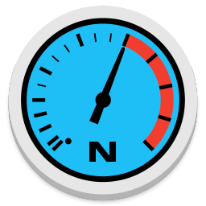
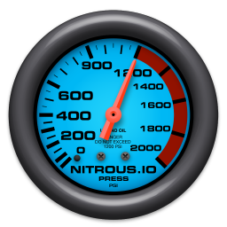

## Vector Logos

Scalable logos for use in print, or to create custom graphics for your website.

<table>
  <tr>
    <td>
      
    </td>
    <td>
      
    </td>
  </tr>
  <tr>
    <td>
      Light Background:&nbsp;
      <a href="/images/logos/nitrous.pdf">PDF</a>
      <a href="/images/logos/nitrous.eps">EPS</a>
      <a href="/images/logos/nitrous.ai">AI</a>
    </td>
    <td>
      Dark Background:&nbsp;
      <a href="/images/logos/nitrous-dark.pdf">PDF</a>
      <a href="/images/logos/nitrous-dark.eps">EPS</a>
      <a href="/images/logos/nitrous-dark.ai">AI</a>
    </td>
  </tr>
</table>

## Raster Logos

These logos are ready to use on your site. Please provide a link to Nitrous when using any of these logos. All images have transparent background.

<table>
  <tr>
    <th rowspan="4" style="padding-right: 10px">
      500px
    </th>
    <td colspan="2">
      
    </td>
  </tr>

  <tr>
    <td colspan="2">
      Light Background:&nbsp;
      <a href="/images/logos/500-black.png">PNG</a>
    </td>
  </tr>

  <tr>
    <td colspan="2">
      
    </td>
  </tr>

  <tr>
    <td colspan="2">
      Dark Background:&nbsp;
      <a href="/images/logos/500-white.png">PNG</a>
    </td>
  </tr>

  <tr>
    <th rowspan="2">
      300px
    </th>
    <td>
      
    </td>
    <td>
      
    </td>
  </tr>

  <tr>
    <td>
      Light Background:&nbsp;
      <a href="/images/logos/300-black.png">PNG</a>
    </td>
    <td>
      Dark Background:&nbsp;
      <a href="/images/logos/300-white.png">PNG</a>
    </td>
  </tr>

  <tr>
    <th rowspan="2">
      200px
    </th>
    <td>
      
    </td>
    <td>
      
    </td>
  </tr>

  <tr>
    <td>
      Light Background:&nbsp;
      <a href="/images/logos/200-black.png">PNG</a>
    </td>
    <td>
      Dark Background:&nbsp;
      <a href="/images/logos/200-white.png">PNG</a>
    </td>
  </tr>
</table>

## Nitrous Gauge Icon

<table>
  <tr>
    <td>
      
    </td>
    <td>
      
    </td>
  </tr>
  <tr>
    <td>
      Flat:&nbsp;
      <a href="/images/logos/flat-gauge-1024.png">1024px</a>
      &nbsp;
      <a href="/images/logos/flat-gauge-512.png">512px</a>
      &nbsp;
      <a href="/images/logos/flat-gauge-256.png">256px</a>
      &nbsp;
      <a href="/images/logos/flat-gauge-128.png">128px</a>
    </td>
    <td>
      3D:&nbsp;
      <a href="/images/logos/nitrous-gauge-1024.png">1024px</a>
      &nbsp;
      <a href="/images/logos/nitrous-gauge-512.png">512px</a>
      &nbsp;
      <a href="/images/logos/nitrous-gauge-256.png">256px</a>
      &nbsp;
      <a href="/images/logos/nitrous-gauge-128.png">128px</a>
    </td>
  </tr>
</table>
