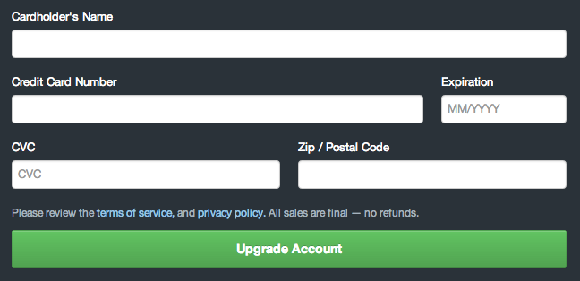

If you are running into any issues when making a payment, take a look below to see if your topic has been covered. If not, [email](mailto:support@nitrous.io) our support team and they will be glad to assist you. 

**Zip / Postal Code**: This will reflect the address you have on record with your credit card company. If your country does not include a postal code which works in this field, try leaving it blank for submission. Some companies do not require the postal code when making a purchase.

**CVC**: The [CVC](http://en.wikipedia.org/wiki/Card_security_code) is your card security code which can be found on the back side of your credit card. It is generally a 3 digit number.

