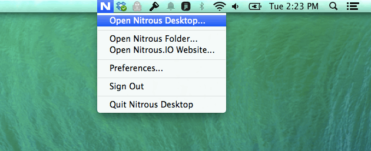
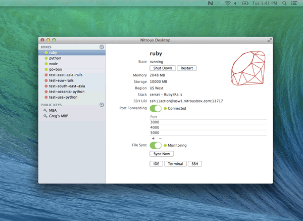

Nitrous Desktop is an app which can be installed on your desktop or laptop. The only version supported at this time is Mac, but Windows support will come soon.

### Installation

#### Mac

You can [download](http://www.nitrous.io/mac) the archived app, and extract it to your Applications folder. 

Once you run the app you will see an 'N' in the menu bar. Click on it and select **Open Nitrous Desktop** to view the settings.

### File Syncing

Nitrous Desktop will create a new folder on your local machine titled 'Nitrous', and will be found in your home folder within Finder. The content within your `~/workspace/` folder will be synced into the newly created Nitrous folder once enabled.

**Enable**: To enable File Sync, open Nitrous Desktop by clicking on the 'N' within the menu bar, and select **Open Nitrous Desktop**.

Next, click on the **File Sync** button to begin syncing. This will continue to monitor and sync any future changes.

### Port Forwarding

Port forwarding will allow you to forward any port to your localhost.

