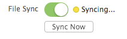
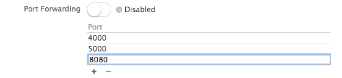
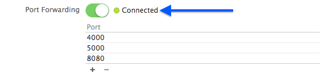
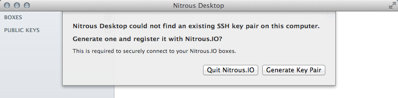
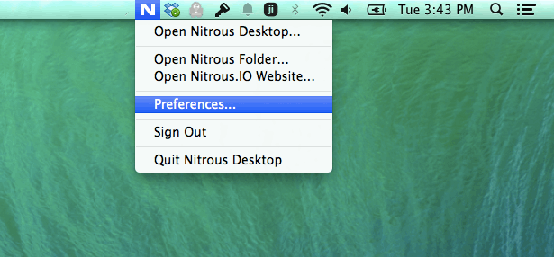
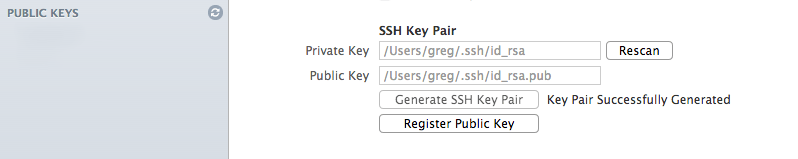

Nitrous Desktop is an app which can be installed on your desktop or laptop. This adds more functionality to your Nitrous account, including File Sync, Port Forwarding, SSH Key mangement, and the ability to Start/Stop/Restart your boxes.

*Windows users: A version for Windows is not yet available, but will be coming soon.*

### Installation

#### Mac

To install, [download](http://www.nitrous.io/mac) the archived app, and extract it to your Applications folder. 

Once you run the app you will see an **N** icon in the menu bar. Click on it and select **Open Nitrous Desktop** to view the settings.

### File Sync

Nitrous Desktop will create a new folder on your local machine titled 'Nitrous', and will be found in your home folder within Finder. The content within your `~/workspace/` folder will be synced into the newly created Nitrous folder once enabled.

**Enable**: To enable File Sync, open Nitrous Desktop by clicking on the **N** icon within the menu bar, and select **Open Nitrous Desktop**.

Next, click on the **File Sync** button to begin syncing. This will continue to monitor and sync any future changes.

### Port Forwarding

Port forwarding allows for network communications within your Nitrous box to be forwarded to your private local area network.

**Enable**: To enable Port Forwarding, click on the `+` icon just below the Port Forwarding button. Enter in the port number you would like to forward, and press Return once finished. You can do this mulitple times to forward multiple ports.

Once you have added the ports you wish to forward, click on the Port Forwarding button to enable:

### Adding an SSH Key

If you have not already [added a SSH key](/categories/ssh/) to your [Public Keys](https://www.nitrous.io/app#/public_keys), you can do this with Nitrous Desktop.

When Nitrous Desktop is opened, you will be prompted to generate and register new SSH keys if not already completed.

If you need to access the settings for your SSH keys, open the preferences by clicking on the **N** icon within the menu bar and select **Preferences**.

You can generate a new SSH Key by clicking on **Generate SSH Key Pair**:

If you have both the SSH Keys available, click **Register Public Key**. You should receive an email confirmation that a new key has been added. You will also see a new key within the Public Keys section of the app.

Once an SSH key pair is established, you will be able to utilize all features within Nitrous Desktop.

### Files not Synced

There are certain file types which will not be synced by Nitrous Desktop. Files such as .git may cause conflicts if utilized locally, and other files may not be of any use on your local machine. Here are a list of file types which are ignored:

* `.unison`
* `.git`
* `.svn`
* `.hg`
* `CVS`
* `.DS_Store`
* `.AppleDouble`
* `.LSOverride`
* `.Spotlight-V100`
* `.Trashes`
* `*.sock`
* `*.sw?`
* `._*` , `*~`
