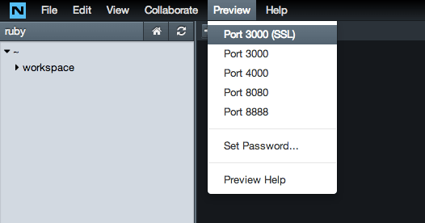

SSL is a cryptographic protocol that is designed to provide communication security over the internet. Enabling SSL will ensure that all information is transmitted securely.

*SSL is currently available in 3 regions; US West, US East, and EU West. Other region support will come soon.*

### Usage

To utilize SSL you will need to configure your app to run on port 3000. Once you are running you running your web app, navigate to **Preview > Port 3000 (SSL)** within the Web IDE.

The app will open in a new tab. To verify SSL is being utilized, ensure `https://` preceeds the domain.
