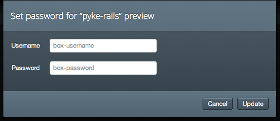
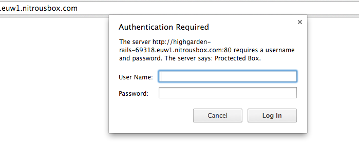

If you're worried about your preview site being accessible by public, you can enable HTTP Basic Authentication to secure it.

To enable HTTP Basic Authentication for Preview, in the IDE open "Preview" menu and select "Set Password". You will be presented with the following dialog box:

Enter a secure username and password and click "Update".

If you reload your preview site, you will now be prompted for a username and password to proceed. Enter the ones you provided in the preivous step. Then the browser will proceed to load the site.

For an added layer of security, we recommend you to make use of the [SSL previewing](http://help.nitrous.io/ssl/) option, if it's available for your region.

