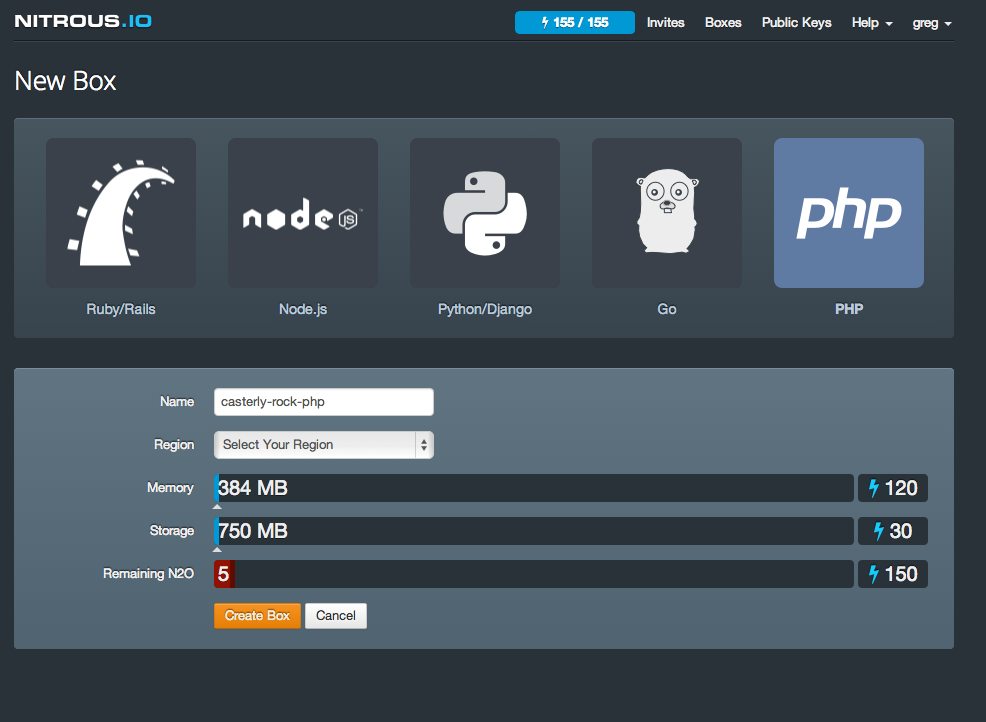
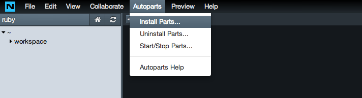
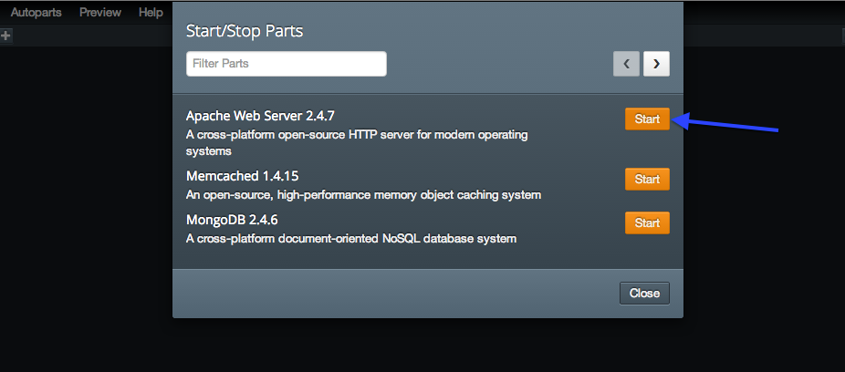
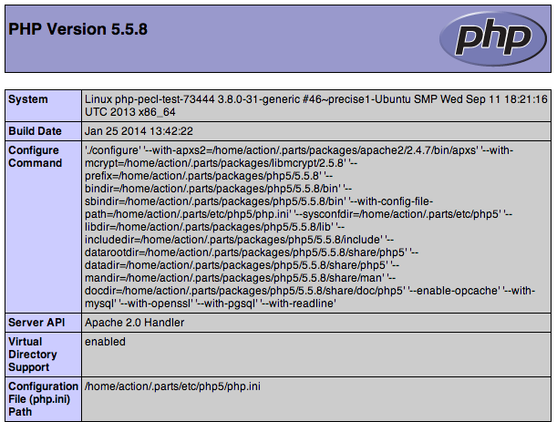

*This guide contains an overview of how to setup PHP5, Apache2, and other PHP related tools on Nitrous. If you are having specific configuration issues, take a look at the FAQ section below.*

### Creating a PHP Box Template

To create a new PHP box, login to your [Nitrous](https://www.nitrous.io) account and create a new box on the [box template](https://www.nitrous.io/app#/boxes/new) page. Select the PHP template and the region which is closest to your location.

### Installing tools with Autoparts

If you are not using a PHP box template, you can install PHP and PHP related tools with [Autoparts](/autoparts). To install any of these parts you will need to navigate to **Autoparts > Install Parts...** within the menu bar.

From there you can view all the parts available. PHP related parts include PHP5, Apache2, and Composer. If you've already installed these tools then they may not display in the install section.

### Starting Apache

Once Apache is installed you will need to start it with [Autoparts](/autoparts). You can do this by running `parts start apache2` in the console. Alternatively you can navigate within the menu to `Autoparts > Start/Stop Parts...`, and start the Apache Web Server.

### Configuring Apache

For configuring the Apache web service we recommend making changes to `httpd.conf`, located within your Nitrous box at `/home/action/.parts/etc/apache2/httpd.conf`. To locate `httpd.conf` within the file browser, ensure you are viewing hidden files by clicking **Show Hidden** just below the file tree.

### Some important paths

php.ini config: `/home/action/.parts/etc/php5/php.ini`

Apache2 httpd.conf: `/home/action/.parts/etc/apache2/httpd.conf`

Apache2 document root: `~/workspace/www`

### FAQs

#### How do I install PHP extensions?

Our default PHP installation is quite lean and comes with a minimal number of extensions installed. You can install the extensions you need for your PHP application using [PECL](http://pecl.php.net/).

We'll walk through setting up the [Zip extension](http://www.php.net/manual/en/book.zip.php) on a Nitrous box as an example.

##### Example: Installing the PHP Zip Extension

First, you'll need to point PEAR and PECL to the active php.ini config:

    pear config-set php_ini /home/action/.parts/etc/php5/php.ini
    pecl config-set php_ini /home/action/.parts/etc/php5/php.ini

Then, use the `pecl` cli tool to install the extension &mdash; this should take awhile to compile so grab a cup of coffee/tea/soy latte:

    pecl install zip

If the installation went well, great! If it failed and you can't figure out why, contact us at [support@nitrous.io](mailto:support@nitrous.io) with the extension you were trying to install and the problems you ran into.

Now, if your Apache server was already running, you'll need to restart it to load the zip extension:

    parts restart apache2

#### How can I enable RewriteEngine?

The RewriteEngine module is already compiled in, but you will need to turn it on. You can do this by adding the following code to the end of the active `httpd.conf` file located in `/home/action/.parts/etc/apache2/`

    <IfModule mod_rewrite>
        RewriteEngine On
    </IfModule>

Alternatively you can edit your `.htaccess` file at the application level to include the following code:

    RewriteEngine On
    RewriteBase /
    RewriteCond %{REQUEST_FILENAME} !-f
    RewriteCond %{REQUEST_FILENAME} !-d
    RewriteRule . /index.php [L]

#### What was PHP compiled with?

If you need to know exactly how PHP was compiled, create a file that contains

    <?php phpinfo() ?>

and load it using Apache2 like so:

    cd ~/workspace/www
    touch phpinfo.php
    echo '<?php phpinfo() ?>' > phpinfo.php
    parts start apache2

Use the [Preview feature](/preview/) to load the page &mdash; you should see something like this:

