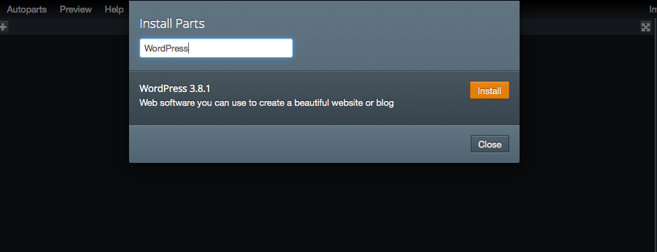
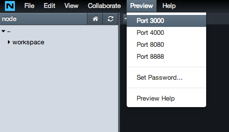
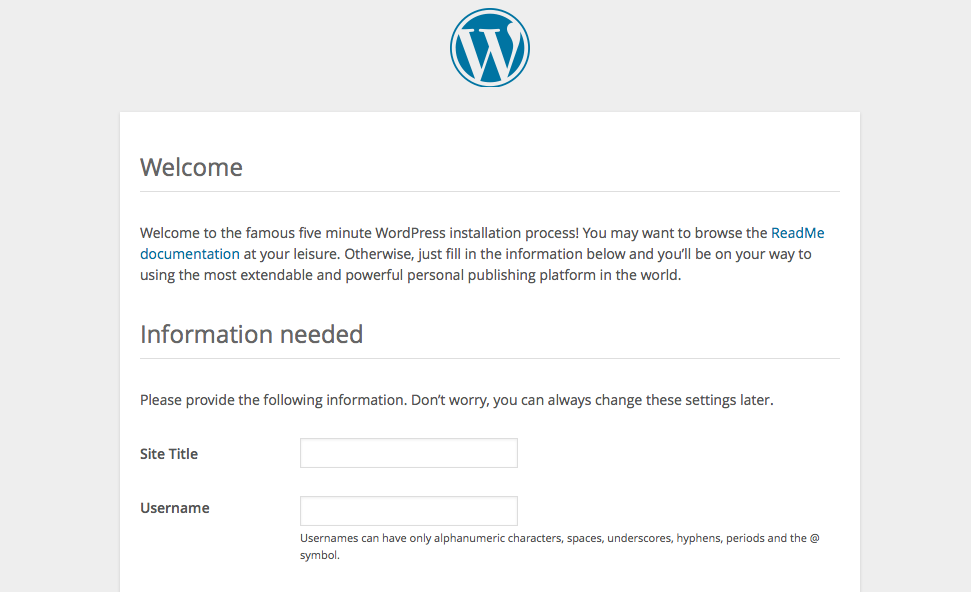

[WordPress](http://wordpress.org) is web software you can use to create a website or blog. It is a CMS (content management system), meaning you can edit and maintain the content within a central interface.

### Installation

To install WordPress within your box you will need to use the package manager, [Autoparts](/autoparts). Navigate in the Menu to **Autoparts > Install Parts...**, and search for *WordPress*.

Installing WordPress will automatically install all dependencies if not yet installed (PHP5, Apache2, MySQL). Once installed, the WordPress installation can be found in `~/workspace/www/WordPress`.

### Previewing Your Site

To connect to your new site, navigate in the menu bar to **Preview > Port 3000**.

Once a new tab opens up you should see the directory leading to your new site. You will be prompted configure your new site.

Once you setup an admin username and password, you can start managing your site within the **wp-admin** subfolder (e.g. `yourbox-subdomain.nitrousbox.com/wordpress/wp-admin/`).