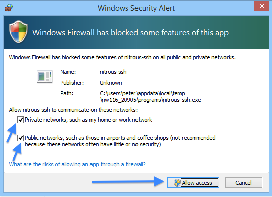
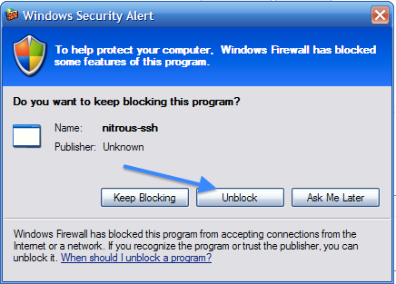
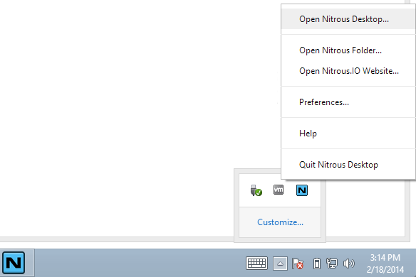
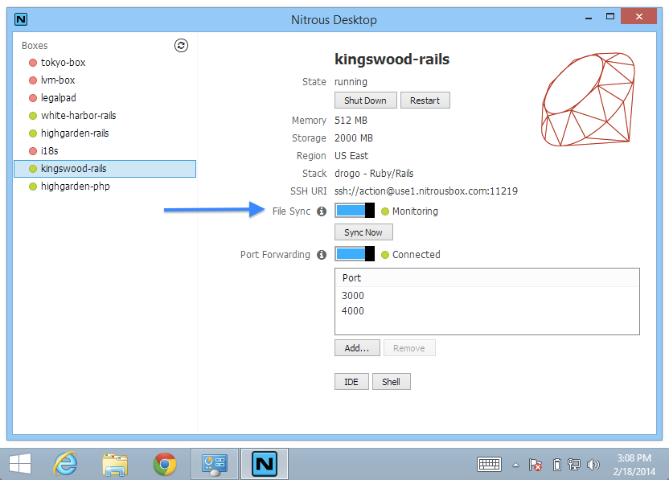
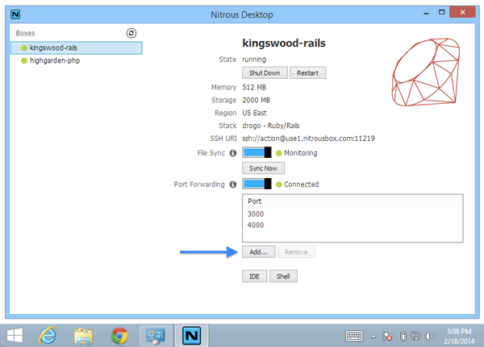
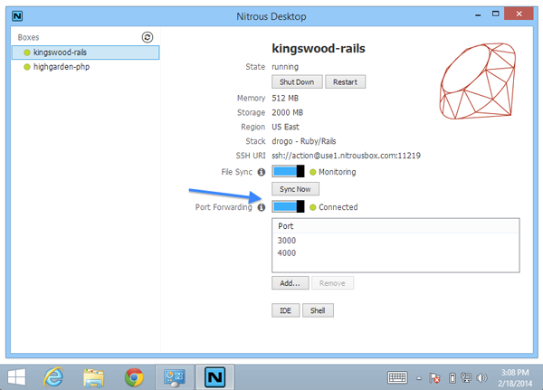
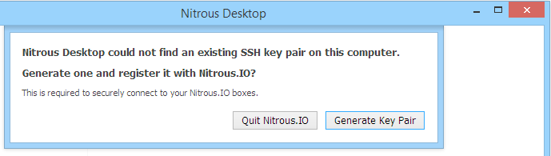
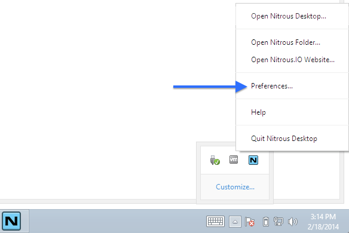
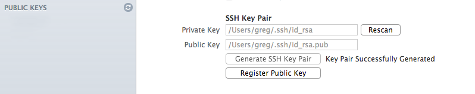
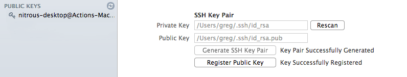

Nitrous Desktop is an app which can be installed on your desktop or laptop. This adds more functionality to your Nitrous account, including File Sync, Port Forwarding, SSH Key mangement, and the ability to Start/Stop/Restart your boxes.

<ul class="inline choices">
  <li><a href="/nitrous-desktop/">Mac</a></li>
  <li class="selected">Windows</li>
</ul>

### Windows Installation

To install, [download](http://www.nitrous.io/mac) the archived app, and extract it to any directory of your choice. Open `nitrousdesktop.exe` to run the app.

When you run the app for the first time you will see a Windows Security Alert. You will need to ensure **Private Networks** and **Public Networks** are checked if available, and you can save these settings by clicking **Allow Access**.

If you are running Windows 7 or 8 the alert will look like the following image:

If you are running an earlier version of Windows then you may see a different Windows Security Alert. Ensure you click **Unblock** in order for the app to function.

Once the app is running, you will see an **N** icon in the taskbar. Right click on the icon and select **Open Nitrous Desktop...** to view the settings.

>Note: Windows 7/8 will hide the Nitrous icon in the taskbar by default. Click the up arrow to find the icon.

### File Sync

Nitrous Desktop will create a new folder on your local machine titled `Nitrous`, and will be found in your `/My Documents` folder. The content within your `~/workspace/` folder will be synced into the newly created Nitrous folder once enabled.

**Enable**: To enable File Sync, open Nitrous Desktop by right clicking on the **N** icon within the taskbar, and selecting **Open Nitrous Desktop...**.

Next, click on the **File Sync** button to begin syncing. This will continue to monitor and sync any future changes.

### Port Forwarding

Port forwarding allows for network communications within your Nitrous box to be forwarded to your private local area network.

**Enable**: To enable Port Forwarding, click the **Add..** button located below the Port Forwarding field. Enter in the port number you would like to forward, and press Return once finished. You can do this mulitple times to forward multiple ports.

Once you have added the ports you wish to forward, click on the Port Forwarding button to enable:

### Adding an SSH Key

If you have not already [added a SSH key](/ssh-windows/) to your [Public Keys](https://www.nitrous.io/app#/public_keys), you can do this with Nitrous Desktop.

When Nitrous Desktop is opened, you will be prompted to generate and register new SSH keys if not already completed.

If you need to access the settings for your SSH keys, open the preferences by right clicking on the **N** icon within the taskbar and select **Preferences**.

You can generate a new SSH Key by clicking on **Generate SSH Key Pair**:

If you have both the SSH Keys available, click **Register Public Key**. You should receive an email confirmation that a new key has been added. You will also see a new key within the Public Keys section of the app.

Once an SSH key pair is established, you will be able to utilize all features within Nitrous Desktop.

### Web IDE

The Web IDE link will open up your default web browser, and take you to the Web IDE of the box selected. It is recommended to have Google Chrome or Firefox installed.

### Files not Synced

There are certain file types which will not be synced by Nitrous Desktop. Files such as .git may cause conflicts if utilized locally, and other files may not be of any use on your local machine. Here are a list of file types which are ignored:

* `.unison`
* `.git`
* `.svn`
* `.hg`
* `CVS`
* `.DS_Store`
* `.AppleDouble`
* `.LSOverride`
* `.Spotlight-V100`
* `.Trashes`
* `*.sock`
* `*.sw?`
* `._*` , `*~`
