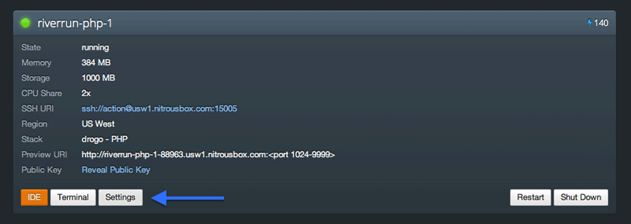
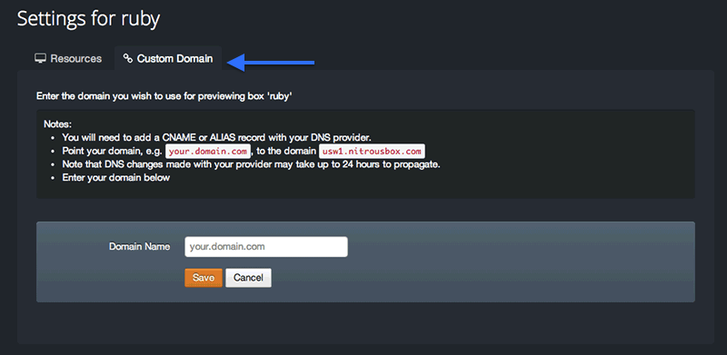

*The [Start and Shift plans](https://www.nitrous.io/app/#/n2o/upgrade) allow you to associate 1 custom domain with your Nitrous box, allowing you to run your app and preview it on your own domain.*

### Setting Up Your Custom Domain

Assuming you have registered a domain name, let's get started.

Navigate to the [boxes page](https://www.nitrous.io/app#/boxes), and click **Settings** within your box information.

On the box settings page, look for the **Custom Domain** tab. On this tab you will be able to enter in the custom domain of your choice.

### Creating a CNAME Record

Within your domain registrar, create a CNAME or ALIAS record with your DNS provider. View the [Google Support Guide](https://support.google.com/a/topic/1615038?hl=en&ref_topic=1687211) for information on setting this up.

Point your domain (e.g. your.domain.com) to your Nitrous box domain. This can be found in the notes within your **Custom Domain** settings in the last step.

DNS changes made with your provider may take up to 24 hours to propagate.

### Previewing Your App

To preview your app with your domain, simply run the app within the console with the appropriate command (e.g. rails server).

Ports 1024 - 10,000 are open within your Nitrous box. To view the app on a specific port just add `:port-number` to the end of your domain when visiting it (e.g. your.domain.com:4000). 

If you wish to view your app directly on your domain (e.g. domain.com), run the app on port 3000. The Nitrous boxes automatically forward this to port 80, eliminating the need for specifying a port within the URI.