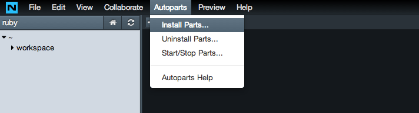
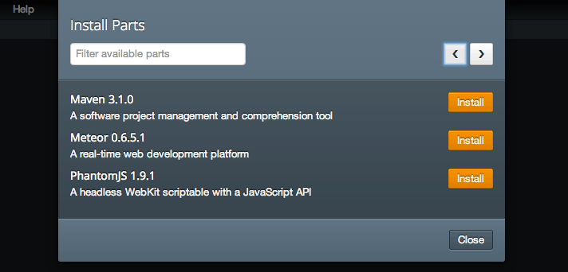
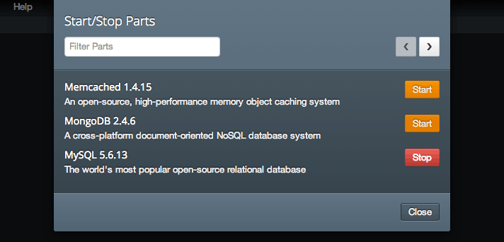

Autoparts is a package manager for Nitrous which allows you to install databases and other tools on your box within your home folder.

*Autoparts is available on all Nitrous boxes created after September 17th, 2013. If your box was created prior to this, please view the README within the [Github Repo](https://github.com/action-io/autoparts) for installation instructions.*

### Installing Packages

You can install a new package by navigating to `Autoparts > Install Parts...` within the menu bar.

Once opened, you can filter or scroll through the available packages which are available for installation.

### Starting and Stopping Parts

*Some parts, such as databases, need to be started after installation.*

If you have installed a database, initialize it by navigating to `Autoparts > Start/Stop Parts...`. Click `Start` next to the parts you wish to run, keeping in mind of the [memory resources](/box-settings/) they will utilize.

*Note: If your Nitrous box is shutdown at any point, you will need to start the database back up the next time the box is started.*

### Command-Line Interface

You can also launch Autoparts from the command line. This is helpful if you are connecting to your Nitrous box via [SSH](/categories/ssh/).

To view all of the packages available to install, run the following command:

    parts search

This will bring up a list including the following tools:

    memcached (1.4.15)         Memcached: An open-source, high-performance...
    meteor (0.6.5.1)           Meteor: A real-time web development platform
    mongodb (2.4.6)            MongoDB: A cross-platform document-oriented...
    mysql (5.6.13)             MySQL: The world's most popular open-source...
    phantomjs (1.9.1)          PhantomJS: A headless WebKit scriptable wit...

Ex: To install MySQL, run the following command:

    parts install mysql

Once MySQL is installed, you will need to start the database. This step is necessary for any database.

    parts start mysql

### Updating Autoparts

New tools, interpreters, and databases are always being added to Autoparts. To update Autoparts with the latest changes, run the following command within the console:

    parts update

### Contributing to Autoparts

If you are wanting to install a tool which is not available within Autoparts, you can [create a new parts package](/contributing-to-autoparts/) by submitting a pull request. The Nitrous team is actively contributing as well, so feel free to [contact us](mailto:support@nitrous.io) with your request.
