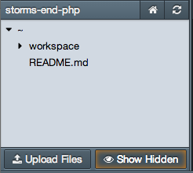
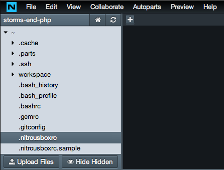

*The `.nitrousboxrc` file allows you to run scripts in non-interactive mode when the Nitrous box starts. This means if your Nitrous box is ever restarted in any scenario (including automatic restarts after maintenance), you can ensure these scripts will start back up.*

### Creating .nitrousboxrc

To use this file, run the following commands in your terminal:

    cp ~/.nitrousboxrc.sample ~/.nitrousboxrc && chmod +x ~/.nitrousboxrc

You can view this file in the file tree by clicking **Show Hidden**:

From there you should see the `.nitrousboxrc` file you just created. If not, click the **refresh** icon at the top of the file tree.

### Usage

Use `.nitrousboxrc` to run commands (start daemons, etc) when your box is started/restarted. The results of running this script will be appended to `/home/action/.nitrousboxrc.log`.

Here is an example file for `~/.nitrousboxrc`:

    !/bin/bash

    # Note: You can also use #!/bin/sh or #!/bin/zsh as the first line.

    # The line below is recommended so that any errors will stop the script.
    set -e

    # Add your commands here

>Note: If you are wanting to keep processes running for an extended period of time, consider signing up for a [paid plan](https://www.nitrous.io/pricing) to keep the box on at all times.
