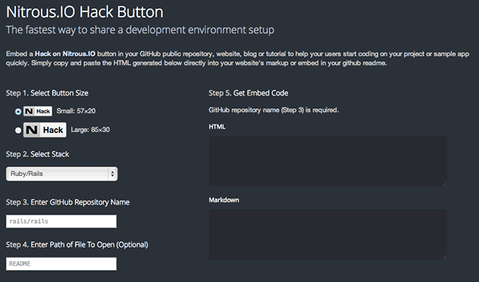
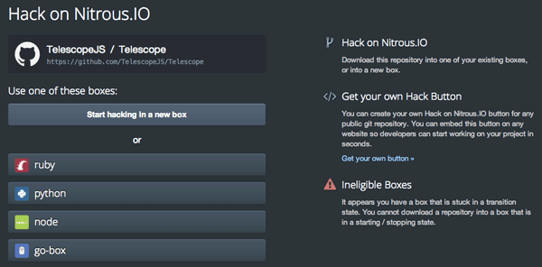
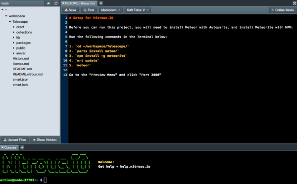

*The 'Hack' button brings ease of access to code repositories, tutorials, and open source apps such as Github. This means that you can let developers test your code immediately by embedding this button on you blog, tutorial, or project repository.*

## Embed a 'Hack' Button on Your own Repo

You can quickly add a 'Hack' button to your own blog, tutorial, or project repository. All that is required is a [public Github repository](https://help.github.com/articles/creating-a-new-repository) which you will be creating the button for. Once this has been done, visit the Hack Button Embed page:

**Hack Button:** [https://www.nitrous.io/embed](https://www.nitrous.io/embed?utm_source=help.nitrous.io&utm_medium=guide&utm_campaign=hackguide)

On the Hack Button Embed page you will see 5 steps: Button Size, Select Stack, Github Repo Name, Path to File, and Embed Code.

Here is a quick overview of each step:

**Step 1. Select Button Size**: Currently there are two sizes; 57x20 and 85x30.

**Step 2. Select Stack**: When selecting your stack, choose the language/framework on which your project runs on. This will determine which stack is created if a developer selects a new box.

**Step 3. Enter Github Repository Name**: This should be in the format of Username/Repository (e.g. [TelescopeJS/Telescope](https://github.com/TelescopeJS/Telescope)).

**Step 4. Enter Path of File to Open (Optional)**: If you have additional steps to configure and run your app, add a `README.nitrous.md` file to your root directory of your project repo. This file will automatically open with the Web IDE once the project is downloaded.

**Step 5. Get Embed Code**: Once the previous steps are included you should see HTML/Markdown in these fields. Embed this code into your blog, turorial, project repository, or anywhere else.

That's it! Now other developers will be able to test and contribute to your projects immediately.

## Download a Project

To download a project to your own Nitrous box, start by clicking an existing 'Hack' button. These links can be found in blog posts, tutorials, and Github Repos.

For example, the 'Hack' below button will download the [TelescopeJS/Telescope](https://github.com/TelescopeJS/Telescope) repository on Github:

Click on a 'Hack' button to download the project. If logged in to [Nitrous](https://www.nitrous.io) you will be given the choice to download the project within a new box, or download the project to an existing box on your account.

Once the project has been downloaded you will be taken to the Web IDE. At this point a `README.nitrous.md` file may open up with further instructions if additional steps are needed.

Follow the steps witin `README.nitrous.md` to configure and preview your project.

If you need assistance with previewing your app, view the [Preview guide](/preview/) for more information.