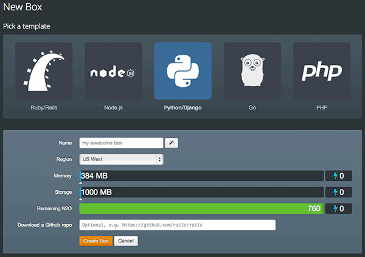
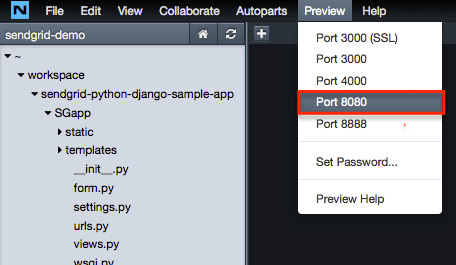
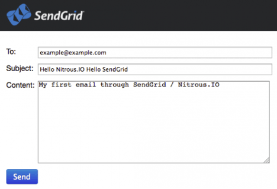
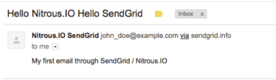

*SendGrid's cloud-based email infrastructure relieves businesses of the cost and complexity of maintaining custom email systems.
SendGrid provides reliable delivery, scalability and real-time analytics along with flexible API's that make custom integration a breeze.*

In this tutorial we’ll use the [SendGrid Django Sample App](https://github.com/sendgrid/sendgrid-python-django-sample-app) to show how easy it is to send email. You’ll want to [create a free SendGrid account](http://sendgrid.com/partners/nitrous-io) and follow these steps:

### Create an Account

From the [Nitrous New Boxes Page](https://www.nitrous.io/app#/boxes/new/?utm_source=sendgrid&utm_campaign=partnership&utm_medium=blog), create a new box using Python/Django.

Launch the IDE and go to the workspace folder in the Nitrous terminal console.

    cd ~/workspace

### Clone and Configure the Sample App

Clone the SendGrid sample application:

    git clone https://github.com/sendgrid/sendgrid-python-django-sample-app.git

Install the SendGrid Python Library:

    pip install --user sendgrid==0.3.1

>The Python package manager will already be installed because Nitrous pre-configures the boxes with software needed for each environment.

In the Nitrous file browser, open `~/workspace/sendgrid-python-django-sample-app/SGapp/settings.py` and change the username/password data to be your SendGrid credentials.

### Run the App

In the console go to `~/workspace/sendgrid-python-django-sample-app` folder:

    cd sendgrid-python-django-sample-app

Now you can start the Python server:

    python manage.py runserver 0.0.0.0:8080

Go to ‘Preview’ menu and select `Port 8080` and the sample application will be opened in your browser.

Send your first email through SendGrid/Nitrous by filling out the form. Now go check your email.

Your message will be there, waiting for you. This is obviously a simple example application which utilizes SendGrid's SMTP relay services. When you use SendGrid in your production Python apps, you’ll likely be sending social notifications, password resets and other [transactional email](sendgrid.com/transactional-email/). Use this project as a starting point or reference for sending email with SendGrid in Python on Nitrous.

**Getting started is simple. Sign up with a free [SendGrid](sendgrid.com/partners/nitrous-io) account and claim your free cloud dev environment in 60 seconds with a [Nitrous account](https://www.nitrous.io/?utm_source=sendgrid&utm_campaign=partnership&utm_medium=blog).**
