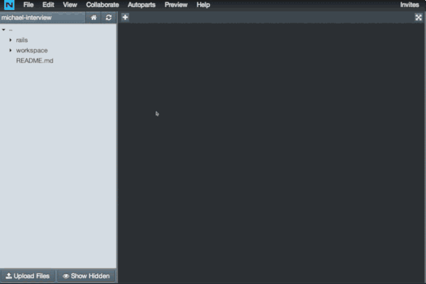
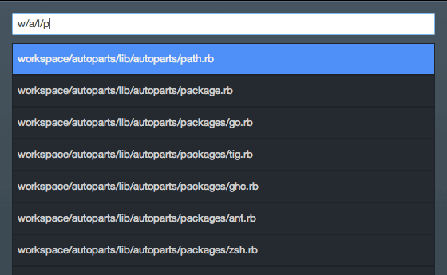

*The Quick Open menu allows you to perform a fuzzy file search for any file within your home directory, and open it in the editor.*

To open the Quick Open menu, navigate in your menu bar to **File > Go to File**. You can also use the keyboard shortcut
**Shift + Control + P** to open the menu.

### Searching Within Current Working Directory

By default your file searches will be performed within the home directory. If you have a file open when using Quick Open then your search will be limited to the parent directory of that file.

### Pattern Searching

You can use a `/` in order to search for files/directories within a parent directory.

For example: In the image below we have searched for w/a/l/p. The results first suggest **w**orkspace/**a**utoparts/**l**ib/autoparts/**p**ath.rb.

