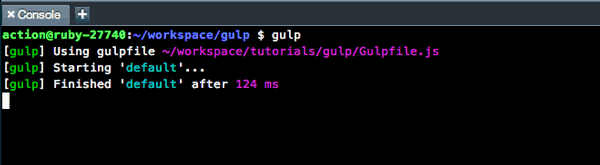
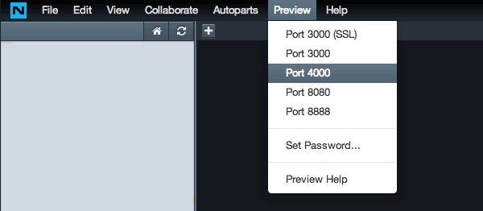
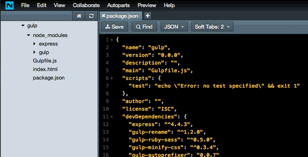
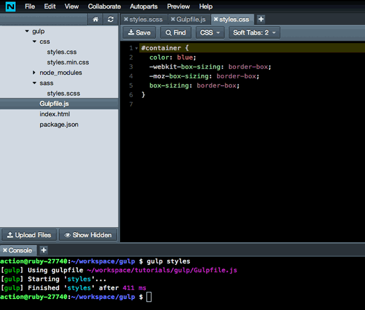

*In this tutorial we will create an Express app while automating tasks with Gulp.JS. The Gulp plugins that you will install include Sass, Minify, Autoprefix, and LiveReload.*

*[Gulp.JS](http://gulpjs.com/) is a task runner which automates frontend processes. This is similar to the task runner [Grunt.JS](http://gruntjs.com/) but there are some key differences. Unlike Grunt, Gulp focuses on code over configuration.*

### Prerequisites

* A [Nitrous.IO Account](https://www.nitrous.io)
* A [Nitrous.IO Box](https://www.nitrous.io/app#/boxes) on Nitrous.IO.

### Installation

Node.JS is a JavaScript runtime environment which will allow us to run all of these wonderful tools. If you selected a Node.JS template when creating a Nitrous.IO box then you are all ready to go. If not then you will still need to install it with [Autoparts](http://help.nitrous.io/autoparts).

Run the following command in the terminal to install Node.JS and npm:

    parts install nodejs

Once Node is installed, install Gulp using npm:

    npm install gulp -g

Gulp is now accessible from the command line.

### Create a New Project

Let's create a folder titled `gulp` within the `~/workspace/` folder to work with.

    cd ~/workspace
    mkdir gulp && cd gulp

With npm you can utilize the command line tool to declare which libraries you want to ue for your project. Scaffold a `package.json` file by running the following command:

    npm init

From here you will be prompted to set project dependencies. You can press return to go through and use the default settings.

Next, install Gulp within the project:

    npm install gulp --save-dev

>Notice that we are using the tag `--save-dev`. This will add gulp as a `devDependency` within `package.json`. If you were to share your project with anyone else then they could simply run `npm install` to automatically install all devDependencies which you installed this way.

### Setting up Express

We will now setup the [Express](http://expressjs.com/) framework with our project. Let's install the dependency within our project:

    npm install express --save-dev

Now we are ready to configure Gulp to start up Express. Create the file `Gulpfile.js` in the project directory and add in an Express function.

In `~/workspace/gulp/Gulpfile.js`:

    var gulp = require('gulp');

    function startExpress() {

      var express = require('express');
      var app = express();
      app.use(express.static(__dirname));
      app.listen(4000);
    }

    gulp.task('default', function () {
      startExpress();
    });

Create a `index.html` file within your project directory for a landing page. Let's keep it simple at this time with a simple hello world. Add the following HTML to `~/workspace/gulp/index.html`:

    <!DOCTYPE html>
    <html lang="en">
    <head>
      <meta charset="UTF-8">
      <title></title>
    </head>
    <body>
      Hello World!
    </body>
    </html>

You can now run `gulp` in the console to run Express.

Once Gulp is running, navigate to **Preview > Port 4000** in the menubar. This will open up a new tab with "Hello World!" displaying at the top.

### Creating Tasks to Compile Sass, Autoprefix, and Minify

#### Preperation

Now that we have have Express running, we can start adding tasks which simplify the development process. In this step we will add tasks to compile sass files, autoprefix the CSS with vendor prefixes, and then minify them.

Install the Sass gem with Ruby for Sass file generation (Ruby is included on all Nitrous boxes):

    gem install sass

Next, run the following command within the project folder to install the plugins needed for the tasks:

    npm install gulp-ruby-sass gulp-autoprefixer gulp-minify-css gulp-rename --save-dev

You should now see a `node_modules/` folder within your project. This will contain all of the packages which we just installed.

#### Setting up Tasks

You will need to create a file within the root directory of your project called `gulpfile.js`, and include all the variables of the plugins we just installed. Below that we will create the task called "styles".

Add the following into `gulpfile.js`:

    var gulp = require('gulp'),
        sass = require('gulp-ruby-sass'),
        autoprefixer = require('gulp-autoprefixer'),
        minifycss = require('gulp-minify-css'),
        rename = require('gulp-rename');

    gulp.task('styles', function() {
      return gulp.src('sass/*.scss')
        .pipe(sass({ style: 'expanded' }))
        .pipe(autoprefixer('last 2 version', 'safari 5', 'ie 8', 'ie 9', 'opera 12.1'))
        .pipe(gulp.dest('css'))
        .pipe(rename({suffix: '.min'}))
        .pipe(minifycss())
        .pipe(gulp.dest('css'));
    });

The first block of variables above will load all of our plugins, and the second block is our first task that we've created. The task is designed to take in all of the `.scss` files, compile them into CSS, and apply autoprefixing to them. The CSS files will be placed in the `css/` folder along within minified files using the `.min` suffix.

In the second block of code we accessed the Gulp API many times. **gulp.task** creates the task, **gulp.src** defines the source files, **.pipe()** is used to pipe source files into a plugin, and **gulp.dest** is used to set the destination path(s). Full documentation on the Gulp API can be found in the [API Documentation on Github](https://github.com/gulpjs/gulp/blob/master/docs/API.md).

### Running Tasks (Sass, Autoprefix, Minify)

Now that we have our first task created let's test it out. Create two folders in your project directory, `css/` and `sass/`. Create `styles.scss` within your `sass/` folder and add the following content:

    $color: blue;

    #container {
      color : $color;
      box-sizing: border-box;
    }

This contains Sass syntax along with the CSS property `box-sizing` which has not been prefixed yet. Run the `styles` task from the project root directory with the following command:

    gulp styles

You should now see `css/styles.css` as well as  `css/styles.min.css`.

Now that we have this task which we can call, how can we automate this task? It's simple. All you need to do is add `gulp.watch` to the existing default task. Update the `default` task in `Gulpfile.js` to look like this:

    gulp.task('default', function () {
      startExpress();
      gulp.watch('sass/*.scss', ['styles']);
    });

Since you don't have to specify a task name for the default task, simply run `gulp` into the console. Once it is running, try modifying the `sass/styles.scss` file to include a different color property. You should see it working within the console, and new sass files will be generated.

    action@ruby-27740:~/workspace/gulp $ gulp
    [gulp] Using gulpfile ~/workspace/tutorials/gulp/Gulpfile.js
    [gulp] Starting 'default'...
    [gulp] Finished 'default' after 126 ms
    [gulp] Starting 'styles'...
    [gulp] Finished 'styles' after 388 ms

Press **Ctrl + C** to kill the Gulp process.

### Set Up LiveReload

Currently we have Express running along Sass, autoprefix, and minify tasks. The next step to simplifying development is to add LiveReload. First we will need to install the tiny-lr plugin along with the connect-livereload middleware which will inject JavaScript into the footer of your pages in order to communicate with Express.

Install the dependencies with the following command:

    npm install tiny-lr connect-livereload --save-dev

You will now need to update the default task within `Gulpfile.js` to include tinylr, and add a function to configure tinylr which will send notifications of file changes.

    var tinylr;
    function startLiveReload() {

      tinylr = require('tiny-lr')();
      tinylr.listen(35729);
    }

    gulp.task('default', function () {
    startExpress();
    startLiveReload();
    gulp.watch('sass/*.scss', ['styles']);
    });

Next, update the Express function to include the connect-livereload middleware by placing it before the **static()** config. This will inject JavaScript at the end of the body section of each page served by express, allowing you to use LiveReload without a browser plugin.

    function startExpress() {

      var express = require('express');
      var app = express();
      app.use(require('connect-livereload')());
      app.use(express.static(__dirname));
      app.listen(4000);
    }

To watch for changes within `html` and `css` files we will need to add one more `gulp.watch` method within the default task. Edit your `Gulpfile.js` file to match the code below:

In `~/workspace/gulp/Gulpfile.js`:

    var gulp = require('gulp'),
        sass = require('gulp-ruby-sass'),
        autoprefixer = require('gulp-autoprefixer'),
        minifycss = require('gulp-minify-css'),
        rename = require('gulp-rename');

    function startExpress() {
      var express = require('express');
      var app = express();
      app.use(require('connect-livereload')());
      app.use(express.static(__dirname));
      app.listen(4000);
    }

    var tinylr;
    function startLiveReload() {
      tinylr = require('tiny-lr')();
      tinylr.listen(35729);
    }

    function notifyLiveReload(event) {
      var fileName = require('path').relative(__dirname, event.path);

      tinylr.changed({
        body: {
          files: [fileName]
        }
      });
    }

    gulp.task('styles', function() {
          return gulp.src('sass/*.scss')
            .pipe(sass({ style: 'expanded' }))
            .pipe(autoprefixer('last 2 version', 'safari 5', 'ie 8', 'ie 9', 'opera 12.1'))
            .pipe(gulp.dest('css'))
            .pipe(rename({suffix: '.min'}))
            .pipe(minifycss())
            .pipe(gulp.dest('css'));
    });

    gulp.task('default', function () {
      startExpress();
      startLiveReload();
      gulp.watch('*.html/*.css', notifyLiveReload);
      gulp.watch('sass/*.scss', ['styles']);
    });

That's it! LiveReload is looking for any changes in your HTML/CSS files, and when you save any changed then the page will automatically refresh.

Use this Gulp setup to make development a breeze.

### Download a Sample App

If you want to jump to the chase and run the app immediately, click this button to download a sample app:

### Recommended Articles

* [Setting up MongoDB with Autoparts](/mongodb/)
