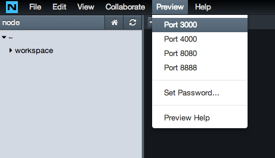
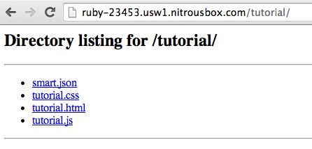

*In situations where you just need to preview a static file without running a web server, try this out.*

With Node.JS you can run a small HTTP server in the project directory or your choice, allowing you to quickly preview any HTML file needed.

To get started, ensure Node.JS has been installed with [Autoparts](/autoparts). Run the following command within your terminal if you need to install it:

    $ parts install nodejs

Install http-server next using NPM:

    $ npm install http-server -g

Next, navigate to your project folder within the terminal and run the command `http-server -p 3000`.

    action@ruby-27340:~/workspace/repos $ http-server -p 3000
    Starting up http-server, serving ./ on port: 3000
    Hit CTRL-C to stop the server

If everything runs smoothly then you will see the "Starting up http-server, serving ./ on port: 3000" message. From here, Navigate to **Preview > Port 3000** within the Web IDE menu bar in order to preview your project.

Click the file within the directory listing which you wish to view. Any referenced CSS/JavaScript will be loaded.

    Available options for http-server:

    -p Port to listen for connections on (defaults to 8080)
    -a Address to bind to (defaults to 'localhost')
    -i Display AutoIndex (defaults to 'True')
    -s or --silent In silent mode, log messages aren not logged to the console.
    -h or --help Displays a list of commands and exits.
