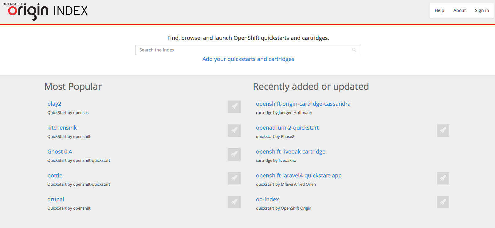
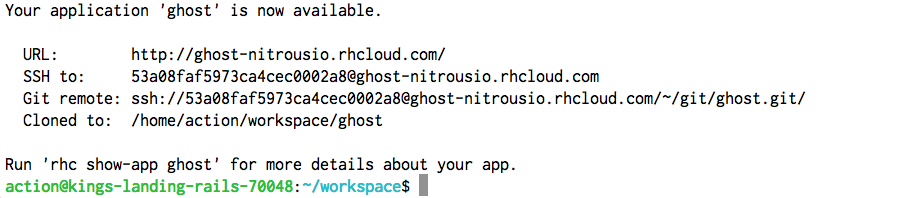
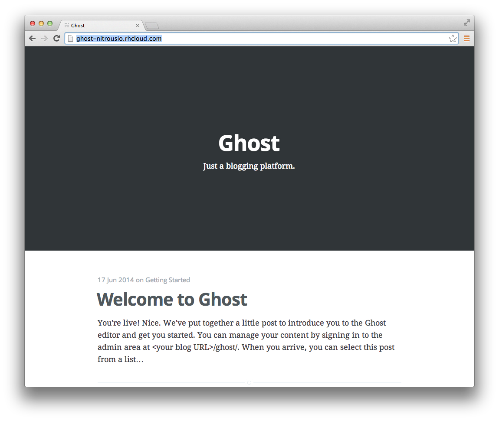
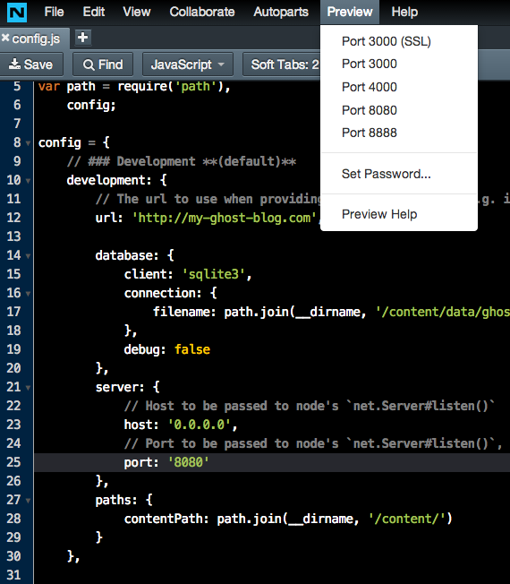
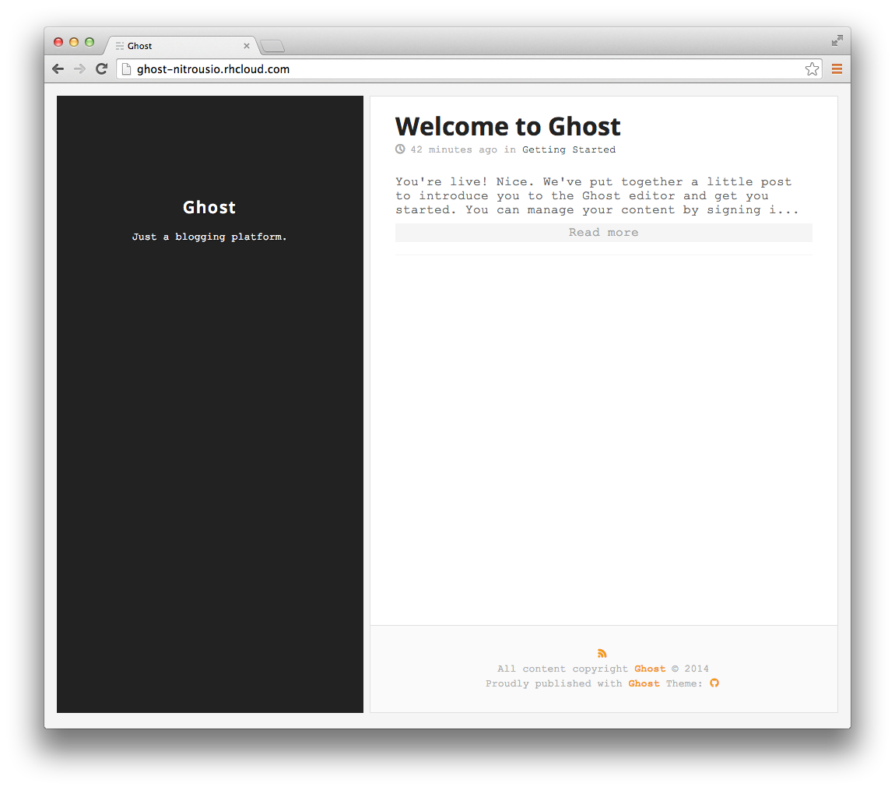

The following guide covers the steps needed to integrate with [OpenShift](http://www.openshift.com), as well as deploying a Ghost blog to your [OpenShift](http://www.openshift.com) account.

### Creating the Accounts

First, [create an OpenShift Account](http://www.openshift.com/app/account/new?{{page.utm}}) and [a free Nitrous.IO Cloud Development enviroment.](http://www.nitrous.io/join?{{page.utm}})

### Installing RedHat Client (RHC)

[Create a Nitrous.IO NodeJS](http://help.nitrous.io/#create-a-new-box?{{page.utm}}) box and launch the linux shell console.

In the linux shell issue the following command to install the RHC.

    gem install rhc
    rhc setup

This installs the OpenShift command line and walks you through the setup process.

### Selecting a QuickStart for your needs

You can see the full list of OpenShift quickstarts at the [quick start gallery.](http://origin.ly/?{{page.utm}})

For this example we will use the popular Ghost Blog quickstart. Click the Ghost Quick start to get the address of the repository

### Creating an App on OpenShift

The RHC command line interface allows us to create the new app with `rhc create app` command the command takes app name, repo source and "cartridges" as parameters. [Learn more about the various options and OpenShift cartridges.](https://access.redhat.com/site/documentation/en-US/OpenShift_Online/2.0/html/User_Guide/)

To create the ghost blog app issue the following command in your Nitrous.IO console.

      rhc app create ghost nodejs-0.10 mysql-5.1 --env NODE_ENV=production
      --from-code https://github.com/openshift-quickstart/openshift-ghost-quickstart.git

The source is duplicated in your Nitrous.IO Environment and the initial code is also deployed to OpenShift at the URL returned by the `rhc create app` command.

You can now go the url to verify that your initial deploy worked as expected.

### Development on Nitrous.IO

Nitrous.IO allows us to customize the Ghost Blog or any other source code as needed. Create a directory to hold the content and add a new theme as a git submodule inside the `ghost` directory.

    cd ghost
    mkdir content/data
    git submodule add https://github.com/Skepton/Pixeltraveller.git content/themes/Pixeltraveller

This updates the code with a new theme but you can of course customize any part of the code using the console and the web editor.

### Staging on Nitrous.IO

One of the benefits of Nitrous.IO's cloud development environments is the ability to live preview your changes before pushing to production.

Edit the `config.js` file to set the development server port to *8080* and the ip to *0.0.0.0*

Install the dependencies and run the server via the console using:

    npm install --production
    npm start

You can preview the application by clicking on *Preview* on the menu bar and selecting *Port 8080*

### Deploying to Production on OpenShift

After you're happy with your customizations you can now deploy the code by using git to commit the code and pushing it to OpenShift. Note: If it's your first time using git on this Nitrous.IO box you will follow the instructions to setup a username and email.

      git commit -am "Added Theme"
      git push

Surf over to your deployment URL and verify that your customizations are now live in production!

