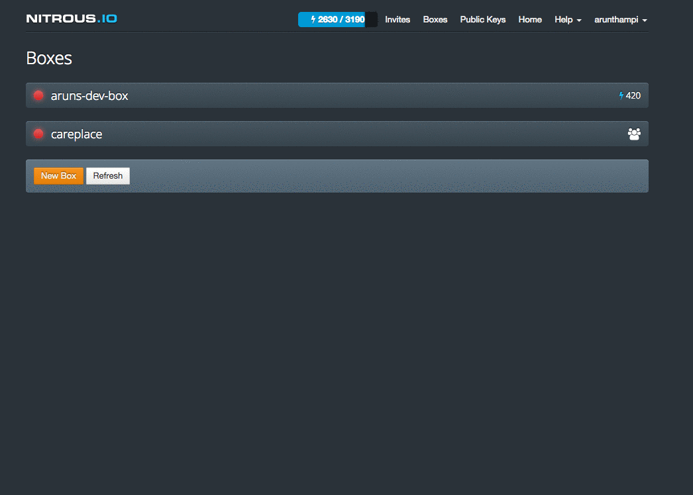
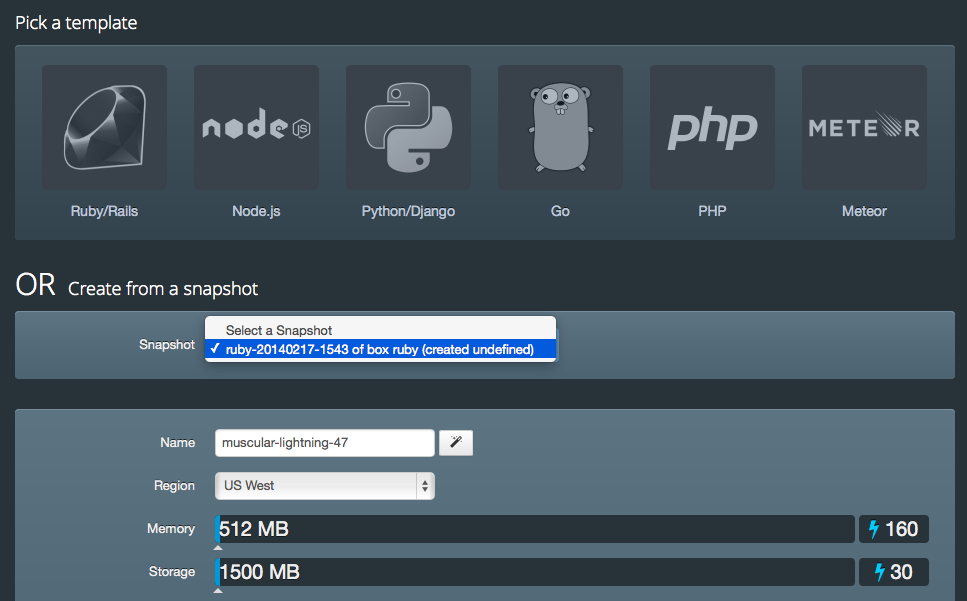

*The [Shift and Turbo plans](https://www.nitrous.io/app/#/n2o/upgrade) provide private box snapshots, which allows you
to create a snapshot of your box at any time, and use it to create a new environment as well as environments for your
co-workers (and inviting them as collaborators).*

### Creating a Snapshot

Within your [box setting page](https://www.nitrous.io/app#/boxes), shutdown the box which you wish to create a snapshot
of. From there, click **Settings**. You will see the **Snapshots** tab at that point which will allow you to title and create a new snapshot.

### Restoring a Snapshot

In order to restore a snapshot, navigate to the [box setting page](https://www.nitrous.io/app#/boxes) and select **New
Box**. From there you will be able to selet an existing template which you created.

You will not need to select an existing template when creating a box based on a snapshot.

Once the box is created you will have restored (or duplicated) your box snapshot.

