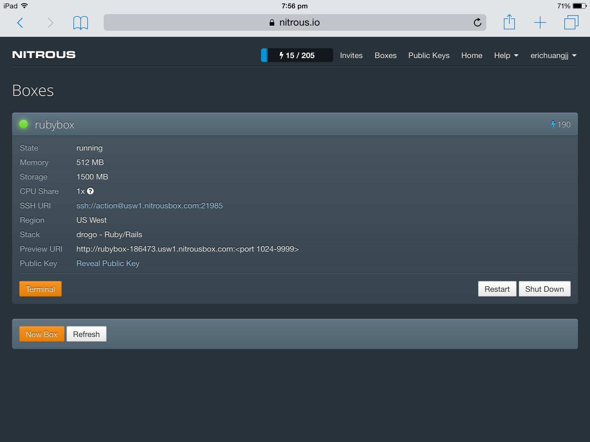
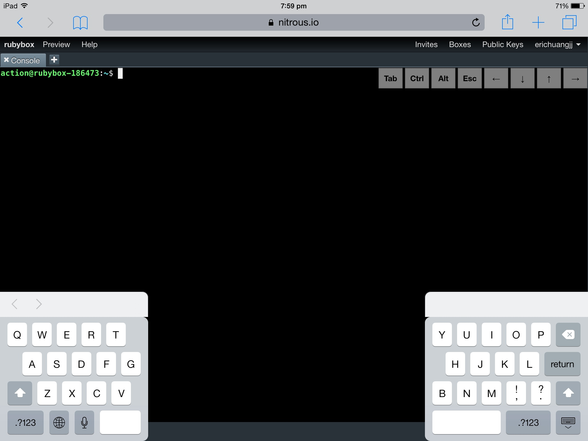
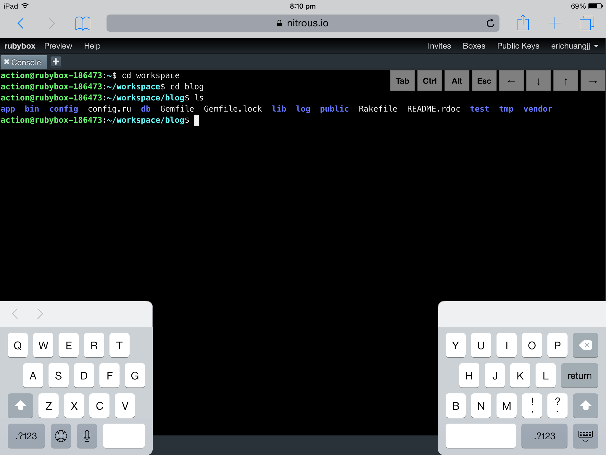
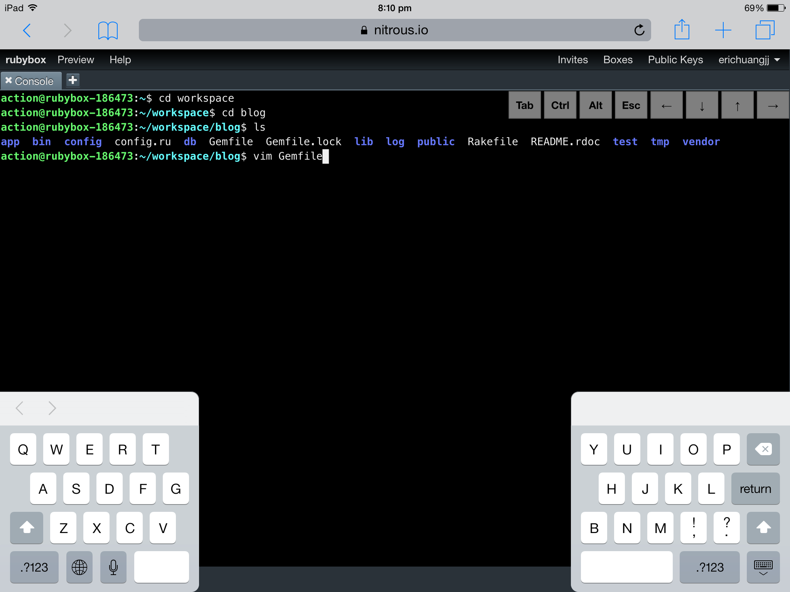
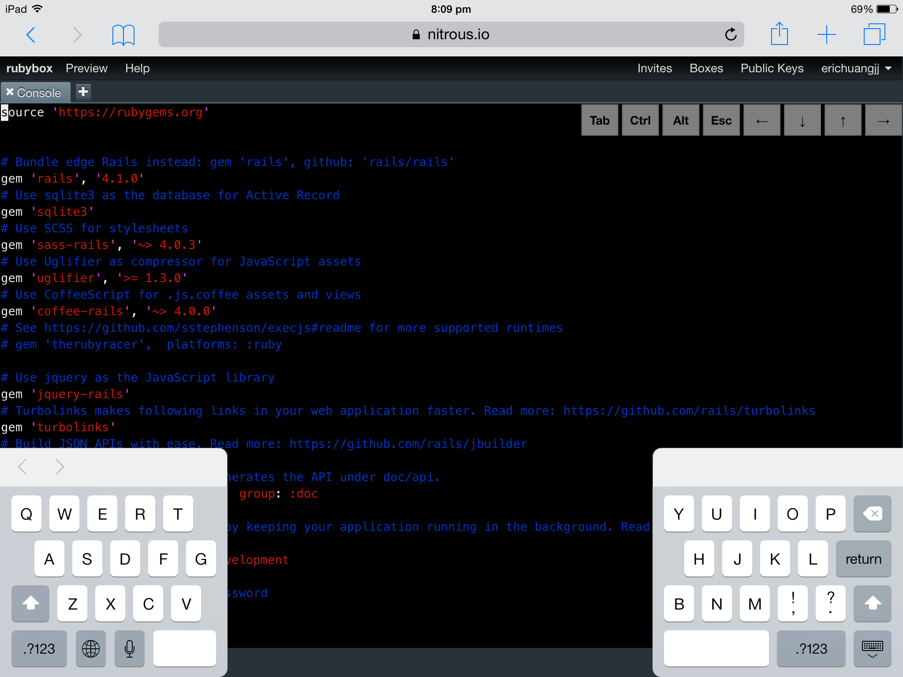

Here’s a quick tutorial on how you can code on the go with Nitrous.IO’s support for iPad. If you are new to [Nitrous.IO](http://www.nitrous.io?{{page.utm}}), simply sign up for a [free account](http://www.nitrous.io?{{page.utm}}), create a development box in seconds and you’d be all set for this tutorial. 

Do check out our [blog post](http://blog.nitrous.io/2015/02/20/coding-on-ipad.html) to find out what makes Nitrous.IO a great platform to code on using your iPad. 

##Open Nitrous.IO Console
Create a development box and tap on ‘Terminal’. This will expand the Nitrous.IO console in fullscreen. 

##Split Keyboard in Console Mode
Now your screen should be displaying the console. Notice that the iPad’s virtual keyboard takes up a significant amount of space - we recommend a split keyboard style or a standalone bluetooth keyboard for maximum screen real estate. 

If you do not own a bluetooth keyboard, fret not. We’ve built a Softkey panel that allows you to enter keys that don’t appear on the virtual keyboard such as tab, ctrl, alt, esc, and directional keys which make real development possible.

##Clone your GitHub Repositories
Inside the console, you can execute shell commands, clone your GitHub repo and perform edits and bug fixes to your project. 

##Edit Code using Vim/Emacs/Nano
For instance, let’s say you want to make changes to the Gemfile in your Rails blog, you can do so by accessing the Vim editor. We support emacs & nano as well.

##Vim Editor
This would be how it looks like to edit code within the Gemfile in vim editor. Again, the virtual keyboard is covering some of the code, a bluetooth keyboard is generally preferred for ease of use. 

Nitrous.IO’s support capability for iPad is still *experimental*, so please send us any issues/feedback so we can continue to improve your experience. Perhaps in the future, we will all be coding on iPads.. But for now, it’s an excellent option for contingency bug fixes on the fly or while on vacation. 

