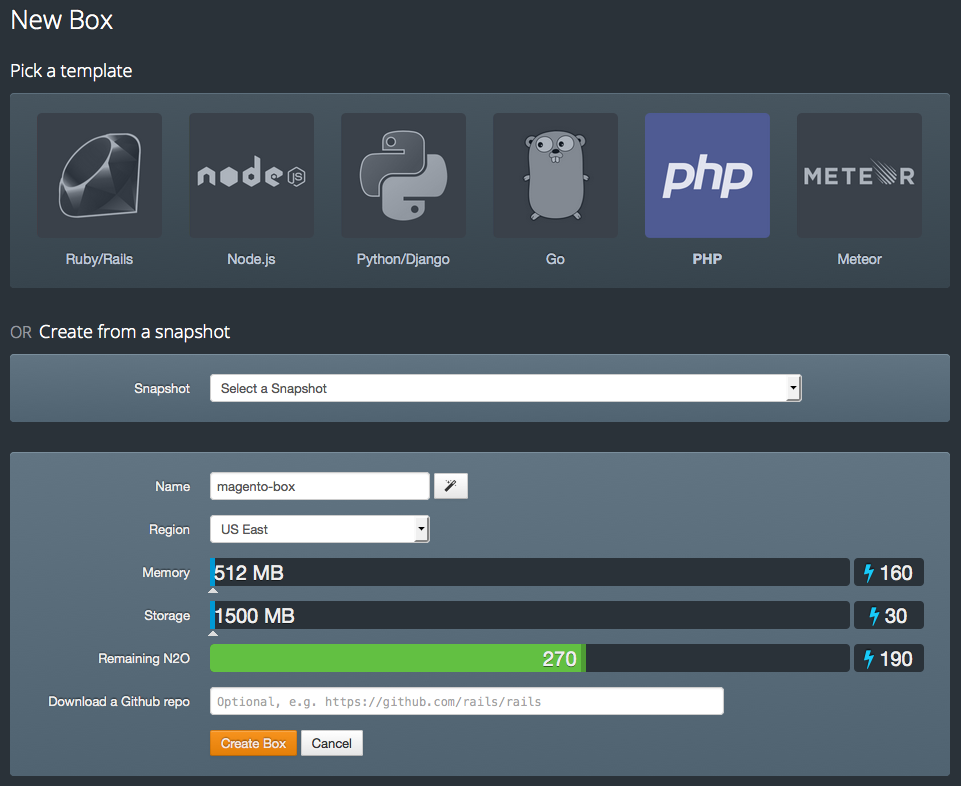
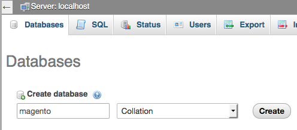
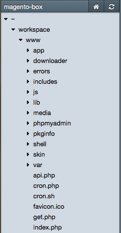
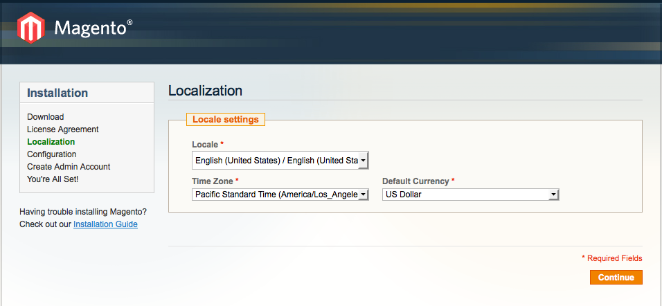
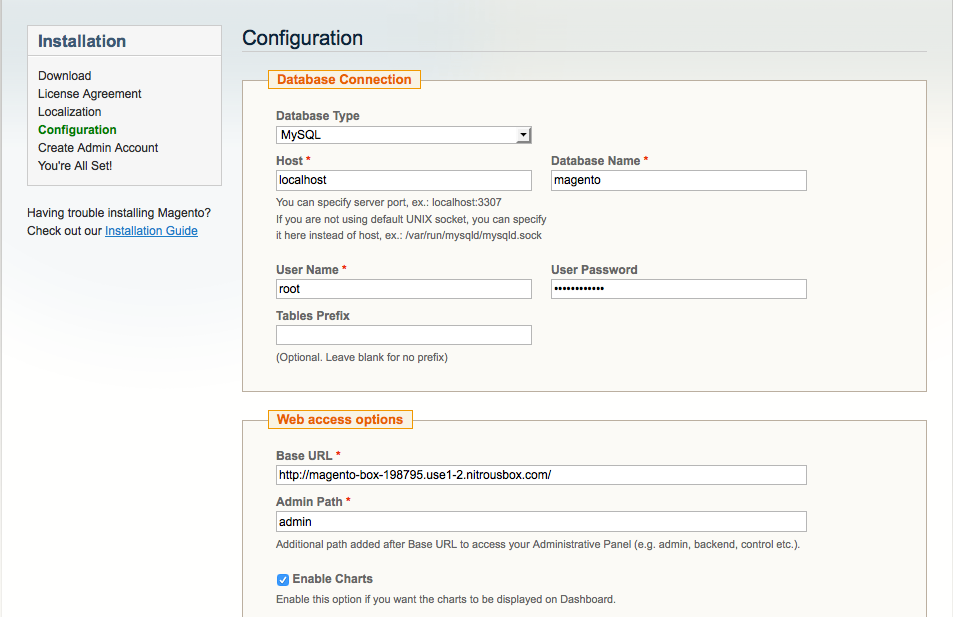
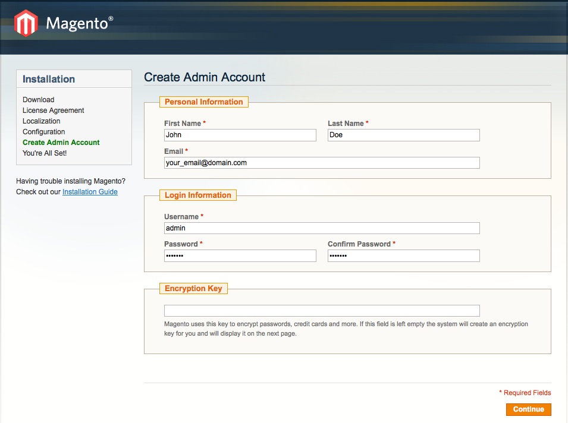

*This installation guide was contributed by [Matt Rhys-Davies - Ecommerce Analyst.](https://mattrhysdavies.com)*

The following guide will detail how to install Magento, the hugely popular open source ecommerce framework on Nitrous. We'll walk through setting up your box on Nitrous, grabbing a copy of Magento and getting it setup.

### Prerequisites

* A [Nitrous account](http://www.nitrous.io?{{page.utm}})

### Create a PHP Box

Now that you’re in your account the first step is to create your environment. This is be done by selecting “Boxes” from the top navigation, and then clicking “New Box” on the following screen, which will take you to a page where you specify the name and language for the box.

Magento runs in PHP so we’ll need to select PHP and give the box a name - I’ve simply gone for “magento-box”. Your screen should now look like the below screenshot.

Now click “Create Box” and after a short delay you’ll be taken to your IDE, already provisioned with Apache & MySQL.

### Create a MySQL Database

Whilst you can manage the MySQL database from the command line if you are so inclined, I am more comfortable with phpMyAdmin, so let’s get that installed. From the top navigation, click **Autoparts > Manage Packages**. Search for “phpMyAdmin” and click the install button once located.

We now need to specify a password for the root database user as phpMyAdmin will not allow access without a password. In the terminal window that you’ll find near at the bottom of the IDE, type the following:

    $ mysqladmin -u root password YOUR_PASSWORD

This sets the password for the root user as “YOUR_PASSWORD”.

Within the menu bar, navigate to **Preview > Port 3000** to open your site within a new tab. From that page click the `phpmyadmin/` subdirectory and then login with the username: “root” and the password that was just set.

Now you’re in phpMyAdmin, click the Databases tab at the top and in the following screen enter a name for your database in the “Create database” field (ex. “magento”) and hit the “Create” button.

Now that we’ve created our database, let’s go back to the IDE so we can acquire the Magento files.

### Install Magento

In the terminal window at the bottom of the IDE, cd into the webroot and download Magento:

    $ cd ~/workspace/www && wget http://www.magentocommerce.com/downloads/assets/1.9.1.0/magento-1.9.1.0.tar.gz

>Note: 1.9.1.0 refers to the current release of Magento Community at the time of writing. This may have changed since, refer to http://www.magentocommerce.com/download in order to find the latest version ID.

We now need to extract the files from the tar, so you will need to execute the following:

    $ tar -zxvf magento-1.9.1.0.tar.gz

When we unzipped the tar file in the command above, all the files were unpacked into a `magento/` directory. Let's move all the application’s files and directories into the web root. To do this, enter the following.

    $ mv magento/* magento/.htaccess .

Now we need to specify permissions on our media, var and app/etc directories respectively with the below commands.

    $ chmod -R o+w media var && chmod o+w app/etc

Finally, let’s remove the tar file with the following command:

    $ rm -rf magento/ magento-1.9.1.0.tar.gz

If all has gone to plan, by hitting the refresh button at the top of the file tree you will see the following.

Now we are required to run through the Magento install UI which will create the necessary files and database tables for the application.

Within the menu bar navigate to **Preview > Port 3000** which will open a new tab. The last time when we did this we were presented a blank page with a single link to phpMyAdmin. Now you will be greeted with Magento’s installation wizard. Click to agree to the terms and conditions. Assuming you do agree to them. If you don’t, well I guess you’re a little stuck.

On the following page specify your Locale, Time Zone and the Default Currency, and then click continue.

On the next page you will be prompted to configure the database connection.

* Host: This should be left as localhost - this is how Nitrous will enable connection to the database
* Database Name: This should be what you named the database when it was created in the above step, mine is “magento”
* Username: This should be left as root
* User Password: This is whatever you specified previously when we set the root password using `mysqladmin`
* Tables Prefix: This should be left blank

Leave the Base URL & Admin Path as they are, and select the checkbox to enable Apache Rewrites. Leave session storage to be stored in the file system.

Now hit continue.

It will take about a minute or two for Magento to create the database, and then it will forward you onto the final configuration page (screenshot below) where you will need to specify the name, user name, password, and email address of the admin user.

>Note: During the setup process you may experience the page timing out. If this is the case then you may want to [increase the box's memory up to 1024 MB](/box-settings/) to resolve the issue. This is only needed during the installation and can be reduced later, once Magento’s successfully installed.

Hitting continue on this page will complete the installation of Magento. The final page is where your encryption key will be published; make sure you save a copy of it as you may need it in the future.

There’s also a short survey to fill in, which I consider worthwhile in order to provide some insight to the Magento team.

We’re done. We now have a fully functioning Magento instance with what was hopefully a short and pain-free installation.

Welcome to Magento; the most powerful open source ecommerce framework around.

