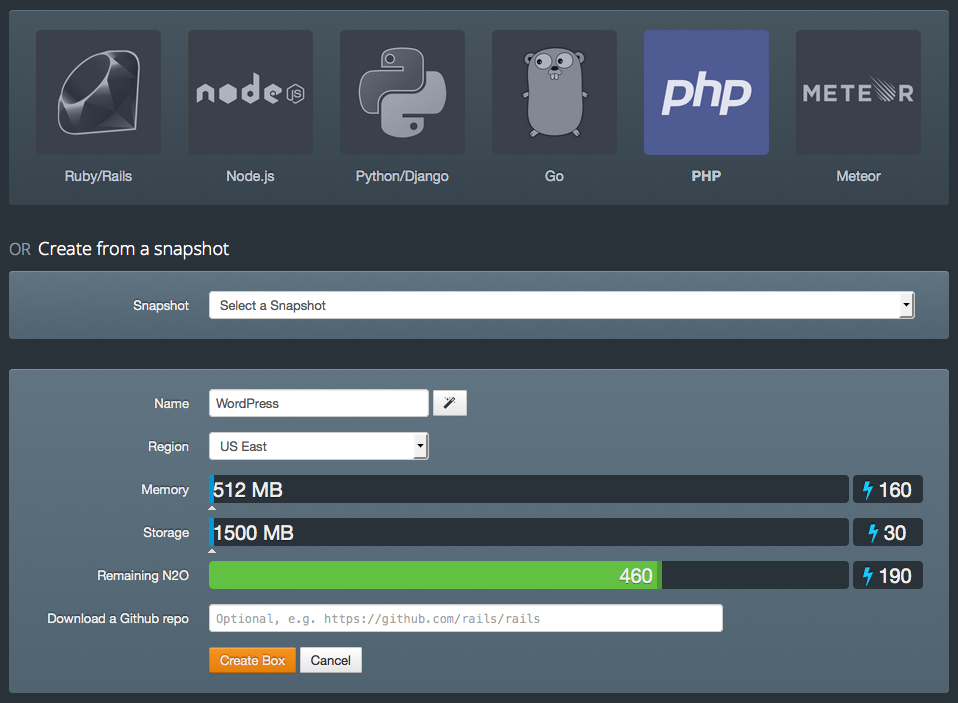
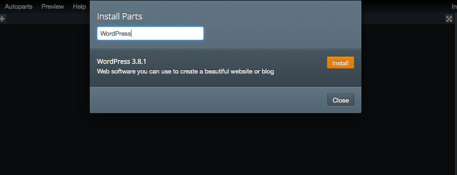
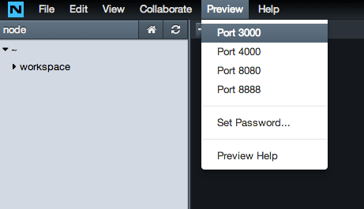
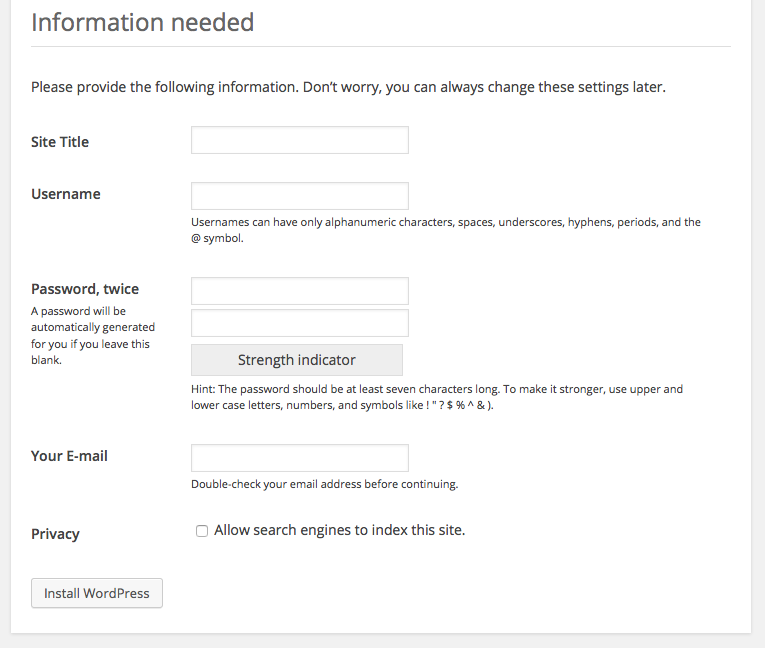

[WordPress](http://wordpress.org) is web software you can use to create a website or blog. It is a CMS (content management system), meaning you can edit and maintain the content within a central interface.

### Prerequisites

* A [Nitrous.IO Account](https://www.nitrous.io?{{page.utm}})

### Create a Box

First you will need to create a box that we’ll install WordPress on. Select PHP as your environment and give the box a name (ex. WordPress).

Select continue and wait while Nitrous builds your dev environment.

### Install WordPress

To install WordPress within your box you will need to use the package manager, [Autoparts](/autoparts). Navigate in the Menu to **Autoparts > Install Parts...**, and search for *WordPress*.

Installing WordPress will automatically install all dependencies if not yet installed (PHP5, Apache2, MySQL). Once installed, the WordPress installation can be found in `~/workspace/www/WordPress`.

### Configuration

To connect to your new site, navigate in the menu bar to **Preview > Port 3000**.

Once a new tab opens up you should see the `Wordpress/` directory leading to your new site. Click on that directory and select your language.

On the next page you will be prompted configure your new site.

The fields you need to fill in here are:

**Site Title**: This is what will be displayed in the top of browsers so do ensure it is descriptive of your site content.

**User Name**: This is the user name that you will use to login to the admin panel

**Password**: This is your password to access the admin panel, so make sure it’s strong and secure.

**Email Address**: The address that is specified here is the email address used for the administration of the site.

**Privacy**: As this is a development box I would suggest to uncheck the Privacy field otherwise search engines may start to index your content, which has the potential to cause slight issues further down the line. Just be sure that when you port the system to production that you change the setting to be indexed: Admin > Settings > Reading > Search Engine Visibility.

Once you've filled out these fields, select **Install WordPress**. You have successfully installed WordPress on Nitrous, and are able to login to the admin panel and start developing.

*Updates to this guide were contributed by [Matt Rhys-Davies - WordPress Ecommerce Developer and Analyst.](https://mattrhysdavies.com)*
