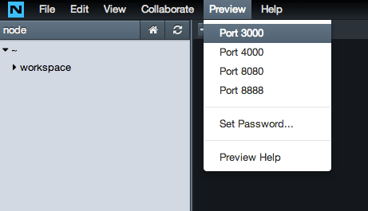
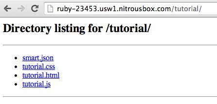

**In situations where you just need to preview a static file without running a web server, try this.**

With Python you can run a small HTTP server in the project directory or your choice, allowing you to quickly preview any HTML file needed. 

To get started, ensure Python has been installed with [Autoparts](/autoparts). Run the following command within your terminal if you need to install it:

    action@ruby-23453:~/ $ parts install python3

Next, navigate to your project folder within the terminal and run `python -m SimpleHTTPServer 3000`.

    action@ruby-23453:~/ $ cd ~/workspace/tutorial
    action@ruby-23453:~/workspace/tutorial $ python -m SimpleHTTPServer 3000
    Serving HTTP on 0.0.0.0 port 3000 ...

If everything runs smoothly then you will see the "Serving HTTP on 0.0.0.0 port 3000 ..." message. From here, Navigate to **Preview > Port 3000** within the Web IDE menu bar in order to preview your project.

Click the file within the directory listing which you wish to view. Any referenced CSS/JavaScript will be loaded.

