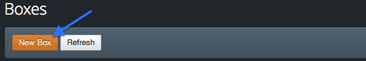

# Getting Started

Nitrous is a backend development platform which helps software developers save time by cutting out the repetitive parts of creating development environments and automating them.

Once you create your first development environment, there are many features which will make development easier.

### Sign Up

Nitrous.IO offers free accounts with basic functionality. Code on Nitrous.IO for as long as you want, and if you feel the need for more speed and a faster box with additional features, you can upgrade to take things to the next level.

* Select “Signup” from the top menu or just [visit the homepage](https://www.nitrous.io).
* Enter your email address, username and password. We utilize your username in various places around the platform, so pick something memorable, simple and meaningful.
* If you already know you want more speed then you can opt for a dedicated box. All the pricing can be found on the [pricing page](https://www.nitrous.io/pricing)

### Create a New Box

To create a new box, just click the “New Box” button on your [dashboard](https://www.nitrous.io/app#/boxes) after signing in.

You will be prompted to select a stack, box name, and a region closest to your location. You can later install other tools and language support with [Autoparts](/autoparts/).

### Autoparts Package Manager

Every box comes with the open source package manager, [Autoparts](/autoparts/). You can utilize Autoparts to install databases and tools, which includes packages like PostgreSQL, Redis, Node.JS, Meteor, PHP, Apache, and more.

You can install a new package by navigating to **Autoparts > Manage Packages...** within the [Web IDE](/ide-general/) menu bar. Some services (e.g. databases) must be started within this menu after installation.

You can also access Autoparts within the terminal. Run `parts help` within the terminal to view all of the available guides.

Read the [Autoparts guide](/autoparts/) for more information on usage.

## Accessing Your Code

### Connect to Github

For those developers using Github, Nitrous.IO lets you easily add your box’s ssh keys. This makes managing your repositories is a breeze.

#### Authenticating

First, you’ll need to authenticate your Github account so we’re allowed to add ssh keys to your profile on Github.

Visit the [bonus page](https://www.nitrous.io/app#/n2o/bonus) and click the **Connect to Github** button. You’ll be redirected to the Github authentication page, where you can review the policies and select **Allow**.

#### Add Box SSH Key to Github

Now that you’ve successfully authenticated your Github account, you’ll be able to add your SSH keys from your Nitrous.IO to your Github account. This will allow you to easily work with your repositories on Github.

Navigate back to the [Dashboard](https://www.nitrous.io/app#/boxes) by clicking the **Boxes** link in the top navigation.

Click any of your boxes to toggle it’s details and click the **Reveal Public Key** link.

Once your public key is revealed, you simply need to click the **Add to Github** link to the right of the key. After a few seconds, you should see the link be replaced with a status message that reads “Added to Github!”.

From here you can now push and pull from your Github repos. If you want to confirm that the key has been added, sign into your Github account and click the **Account Settings** link in the top right navigation, and then **SSH Keys** on the left nav.

### Connect via SSH

With SSH Established you can open a local terminal and code directly on your Nitrous box. If you use this method to develop then you may want to consider using Vim to edit your code.

To utilize SSH, you will first need to add your public key (`~/.ssh/id_rsa.pub`) to the [Public Keys](https://www.nitrous.io/app#/public_keys) page.

For assistance on setting up SSH, take a look at one of the following guides:

* [Mac](/ssh-add/)
* [Windows](/ssh-add-win/)

#### Using iTerm2 with Mac

One easy strategy for Mac users would be to use [iTerm 2](http://www.iterm2.com/) and setup a profile with your SSH credentials. To setup a profile, navigate to your [dashboard](https://www.nitrous.io/app#/boxes) and copy your SSH URI:

Next, open up Iterm 2 and navigate to **Preferences > Profiles**. Create a new profile and fill in your SSH URI into the Command field. The format should be **ssh action@YOUR_REGION.nitrousbox.com -p YOUR_PORT** ([view screenshot](/images/articles/iterm2-profile.png)).

### Sync with Nitrous Desktop

With Nitrous Desktop you can sync your files locally, allowing you to edit code on your Nitrous box with your favorite text editor (e.g. Sublime Text). You can also enable port forwarding, start/shutdown boxes, and more.

If you are running Mac or Windows, visit the [download page](https://www.nitrous.io/desktop) and install the application. From there you can follow either of these guides for information on how to use the app:

* [Mac](/nitrous-desktop/)
* [Windows](/nitrous-desktop-win/)

## Build Your App

You can create as many projects as you would like within a single Nitrous box. The only limitations to this is the amount of storage space you use, which not only counts the project files but also modules, different versions of Ruby installed, etc.

Below you will see a screenshot of how you could setup your directories within Nitrous. All projects should be places within the `~/workspace` folder, and configuration files can be placed in your home directory `~/`.

Build your app just as you normally would on your local environment. If you install any databases by Autoparts, set any database configurations to utilize `localhost`.

### Collaborate with Others

If you want to work on a project with another developer, invite them to collaborate on your Nitrous box. You will be able to work on the same code at the same time, and even view the what other collaborator’s are typing in real time.

View the [collaboration guide](/collab/) for details on using this feature.

### Tutorials

You can use any tutorial found on the web to get started, but remember that you don’t have root access. For certain tools that may ask you to run ‘sudo apt-get’, check [Autoparts](/autoparts) to see if the package exists there.

Build your first app by [following one of these tutorials](/categories/tutorials/).

## Preview Your App

You can preview and share your web app on a public URL while it is running within your active session.

The **Preview** menu in the Web IDE displays links to some common default ports, which you can click to open a new window in your browser.

Ports 1024 - 10,000 are open for HTTP, and port 80 is forwarded to port 3000. If your app is running on port 80 in the terminal, navigate to ‘Preview > Port 3000’ in the menu.

If the app is running on another port not found in the menu then you will need to change this within the address bar (e.g. http://ruby-21200.usw1-2.nitrousbox.com:8080).

If you wish to use a custom domain, take a look at which [pricing plans](https://www.nitrous.io/pricing) offer this feature.

You can read more about previewing on the [preview guide](/preview/).

## Deploy

Nitrous.IO is dedicated to bringing the best development and staging environments at this time. Although you could keep your Web App running by using [Tmux](/faq-disconnect/) and a [paid plan](https://www.nitrous.io/pricing), we recommend deploying to one of the following services for your production app:

* [Heroku](/heroku)
* [Google App Engine](/app-engine)
* [Azure](/azure-sites)
* [OpenShift](/openshift)
* [Nodejitsu](/nodejitsu)
* [Cloud 66](/cloud66)
* [Shelly Cloud](/shelly-cloud)
